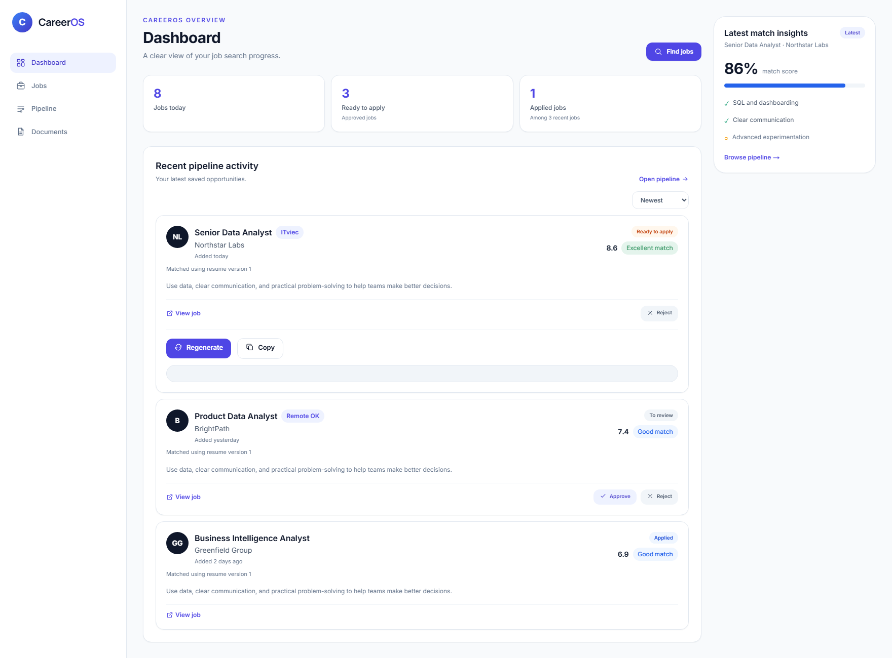

# CareerOS

**A job-search assistant that helps you decide which opportunities are worth your time.**

Add your resume and a job listing. CareerOS highlights how your experience fits, what may be
missing, and any possible warning signs—so you can make a more informed choice.

*Dashboard preview with sample data.*

## How it works

1. Add your resume.
2. Find jobs or paste in a job description.
3. Review the match, relevant experience, gaps, and possible scam warnings.
4. Choose what to do next and keep track of each opportunity in your pipeline.

CareerOS offers guidance, not a hiring decision. AI can make mistakes, so review the original job
posting and decide for yourself. **It never applies for a job or sends an email on your behalf.**

## What you can do

- See how a job's requirements compare with your resume.
- Spot potential scam signals and review why a warning appeared.
- Keep job opportunities and application progress organized in one place.
- Discover jobs from ITviec and Remote OK, draft cover letters, or optionally sort application
  emails in read-only mode.

## Run locally

CareerOS is a local development project, not a hosted service. Running it requires Docker, Python,
Node.js, and Ollama for local AI features.

1. Copy `infrastructure/.env.example` to `backend/.env` and set any needed options.
2. Start the database with `docker compose up -d postgres` from `infrastructure/`.
3. In `backend/`, run `pip install -r requirements.txt` and `alembic upgrade head`, then start the
   API with `uvicorn app.main:app --reload --port 8000`. Run `python -m app.worker` in a second
   terminal to enable scheduled job collection.
4. In `frontend/`, copy `.env.local.example` to `.env.local`, run `npm install` and `npm run dev`,
   then open <http://localhost:3000>.

For local AI matching, start Ollama and download the models configured for the project. Cover-letter
drafting also requires an Anthropic API key.

## More about the project

See [the hybrid-model journey](./docs/hybrid-model-journey.md) for how CareerOS evaluates matching
approaches.
